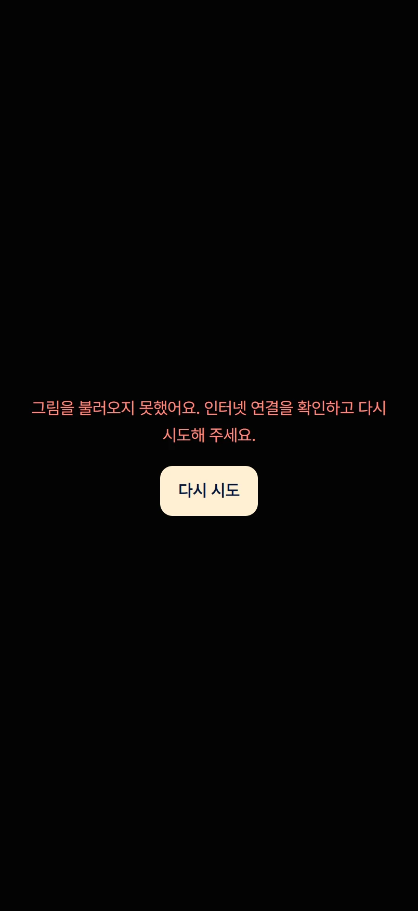
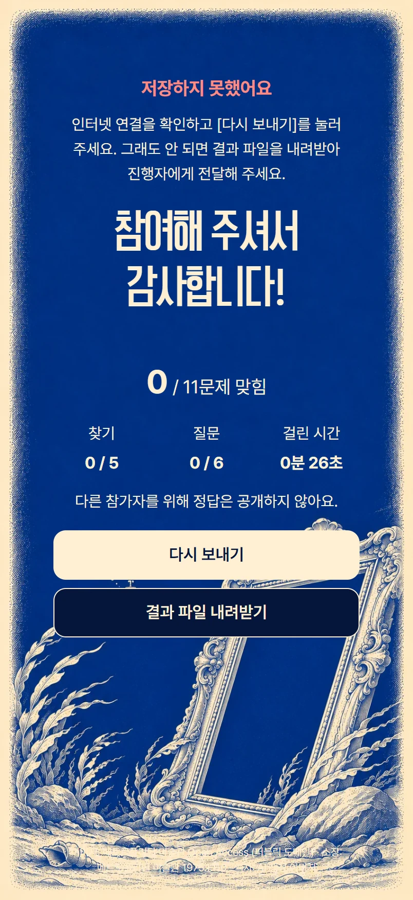
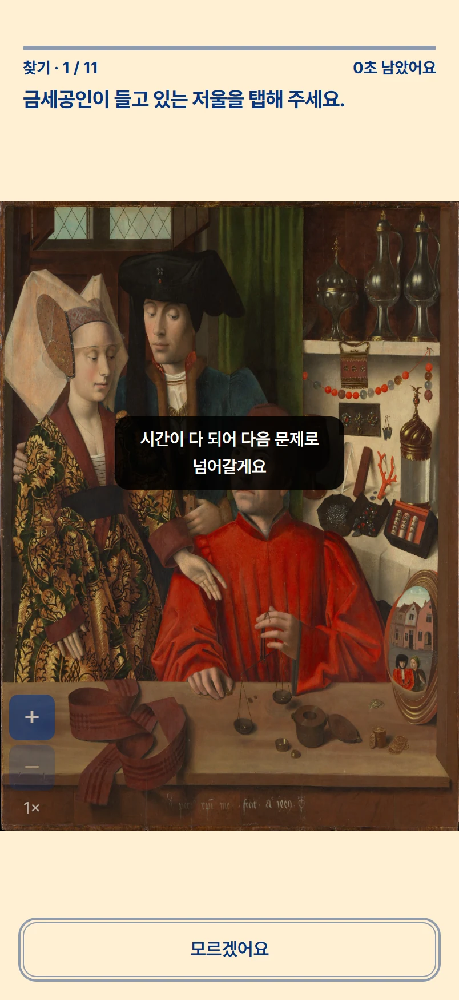

# DIVE (다이브) — Dive Inside, Visually Explained

> 미술관에서 오디오 도슨트를 들을 수 없는 청각장애인 관람객은, 글 설명만으로는 "그림의 어느 부분이 무엇을 뜻하는지"를 글과 그림을 번갈아 보며 직접 찾아야 해서 작품을 깊이 감상하기 어렵다.

- **소개 페이지 + 시연**: https://dive.eosangkyung.workers.dev/
- 시연만 바로 보기: https://dive.eosangkyung.workers.dev/demo/?mode=demo&art=goldsmith

## 무엇을 하는 서비스인가

작품 옆 QR을 찍으면, 해설이 설명하는 부분으로 **그림이 확대·이동하고 그 부분만 밝게 강조**되며, 해설은 자막으로 나온다. 관람객은 글과 그림을 오가며 찾지 않아도 "지금 이 부분 이야기"라는 것을 바로 알 수 있다.

- 사용자: 문자 자막을 읽을 수 있는 청각장애인 관람객(난청·후천적 청각장애). 수어 영상 지원은 이번 범위 밖
- 형태: 휴대폰 세로 화면용 정적 웹(HTML/CSS/JS). 디자인 기준 아이폰 17(402×874), PC에서는 402×874 틀로 보여 준다
- 3D 재현 대신 확대·이동 애니메이션(0.85초)으로 시선을 옮긴다
- 시연 작품: 페트루스 크리스투스 〈작업실의 금세공인〉(1449), 얀 반 에이크 〈아르놀피니 부부의 초상〉(1434). 해설은 각 소장처 공식 설명에서 벗어나지 않게 썼다

## 결과 — 글 설명(A) vs 확대·강조(B)

11/2 본 테스트, 〈작업실의 금세공인〉, 완료자 A 6명 · B 9명. 찾기 성공은 첫 탭 기준, 시간은 맞힌 문제의 중앙값.

| | A 글 설명만 | B 확대·강조 |
| --- | --- | --- |
| 전체 정답률 | 64% | **76%** |
| 찾기 정답률 | 70% | **84%** |
| 찾기 시간 (맞힌 것) | 5.1초 | **2.5초** |
| "어느 부분 이야기인지 바로 알 수 있었다" (1~5) | 3.3 | **4.6** |

- 작은 대상일수록 차이가 컸다 (수정 용기 찾기 33% → 89%, 매 찾기 17% → 67%)
- 위치가 없는 해설(인물의 정체 같은 해석)은 B가 오히려 낮았다 (67% → 33%) — 확대·강조는 "어디"를 찾는 데 강하고, 기억을 돕지는 못한다
- 한계: 그룹당 6~9명이라 통계 검정 없이 경향으로만 말한다. 재참여자가 섞여 있고, 대부분 PC(마우스)로 참여해 실제 사용 상황(미술관·휴대폰)과 다르다
- 10/29 베타 테스트(〈아르놀피니 부부의 초상〉)도 같은 방향이었다 (정답률 63% → 79%)

## 안정성 — 막아 둔 상황

본 테스트 버전(v2) 기준. 모든 안내는 소리 없이 글자와 화면으로만 전달한다. 화면 캡처는 [`docs/screenshots/03_states/`](docs/screenshots/03_states/).

| 상황 | 화면에서 하는 일 |
| --- | --- |
| 그림을 불러오는 중 | 돌아가는 표시 + "그림을 불러오고 있어요…" |
| 그림을 불러오지 못함 | "그림을 불러오지 못했어요. 인터넷 연결을 확인하고 다시 시도해 주세요." + [다시 시도] |
| 잘못된 링크 (없는 작품·그룹 주소) | "잘못된 링크예요. 받은 링크를 다시 확인해 주세요." — 엉뚱한 화면으로 시작하지 않음 |
| 결과 저장 중 | "창을 닫지 말아 주세요" 경고, 저장이 끝나면 "저장 완료"로 바뀜 |
| 결과 저장 실패 | "저장하지 못했어요" + [다시 보내기] + [결과 파일 내려받기] — 기록을 잃지 않게 |
| 문제당 1분 제한 | 남은 시간 표시, 마지막 10초 강조, 시간이 다 되면 "다음 문제로 넘어갈게요" 안내 후 자동으로 넘김 |
| 같은 사람이 다시 참여 | "이미 참여하셨어요" — 한 사람당 한 번만 |
| 끝난 테스트 링크 | "베타 테스트는 끝났어요" 안내만 보임 |
| 작은 화면·긴 글 | 아이폰 17(402×874) 기준, 휴대폰은 화면에 맞추고 긴 문장은 줄바꿈 |
| 개인정보 | 이름·연락처를 받지 않고 무작위 ID(`P` + 4글자)만 남김 |

<p>





</p>

## 실행 방법

> 필요한 것: Git, Python 3 (로컬 서버용). 별도 설치 패키지는 없다.

1. 저장소 받기
   ```bash
   git clone https://github.com/eosangkyung-jpg/1st_proj.git
   cd 1st_proj
   ```
2. 소개 페이지 켜기 (파일을 바로 열면 시연 화면이 스크립트를 못 불러오므로 로컬 서버로 연다)
   ```bash
   cd site
   python -m http.server 8002
   ```
3. 브라우저에서 열기
   - 소개 페이지: http://localhost:8002/
   - 시연만: http://localhost:8002/demo/?mode=demo&art=goldsmith (또는 `art=arnolfini`)
   - 발표 모드(화면을 창 높이에 꽉 차게): http://localhost:8002/demo/?mode=present
   - 휴대폰 화면으로 보려면 브라우저 개발자 도구의 기기 모드에서 402×874로 맞춘다

시연 화면은 테스트 웹과 같은 코드지만 기록 주소를 비워 두어, 눌러 봐도 아무 데이터도 보내지 않는다.

### 배포 (Cloudflare)

`site/`에서 만들기 스크립트만 뺀 폴더를 Cloudflare 대시보드 → Workers & Pages → 프로젝트 `dive`에 끌어다 놓는다.

```bash
rm -rf deploy_site && cp -r site deploy_site && rm deploy_site/build_site.py
```

### 테스트 결과 분석 (pandas)

```bash
pip install pandas matplotlib
python analysis/analyze_main.py   # 본 테스트 (11/2, A vs B v2)
python analysis/analyze_beta.py   # 베타 테스트 (10/29, A vs B v1)
```

- 입력 CSV(참가자 응답 원본)는 저장소에 넣지 않았다. 파일이 없으면 "[에러] 파일이 없습니다"를 보여 주고 멈춘다
- 지표 정의와 계산 과정은 두 스크립트 맨 위 설명과 코드에서 확인할 수 있다

## 폴더 구조

```
site/            소개 페이지 (index.html) — 배포되는 결과물
  demo/          B 해설 시연 (테스트 웹 B 화면의 복사본)
  footer/        첫 화면 심해 액자 루프 이미지
  build_site.py  원본에서 시연 복사본을 다시 만드는 스크립트 (작업자용)
analysis/        사용성 테스트 분석 스크립트 (pandas)
CLAUDE.md        AI(Claude Code) 작업 규칙 — 디자인 기준값, 화면 규칙
PRODUCT.md       테스트 웹의 목적·사용자·제약
```

사용성 테스트 웹(A/B 배정, Google 시트 기록)과 작업 기록 원본(`records/`)은 참가자 기록이 섞여 있어 저장소에 넣지 않았다.

## 사용한 데이터

- 작품 이미지: 〈작업실의 금세공인〉 메트로폴리탄 미술관 Open Access(퍼블릭 도메인, 1975.1.110) · 〈아르놀피니 부부의 초상〉 위키미디어 공용(퍼블릭 도메인, 런던 내셔널 갤러리 NG186)
- 해설: 각 소장처 공식 작품 설명을 바탕으로 직접 작성
- AI 생성 이미지: 해설 화면의 액자, 시연 끝 화면, 소개 페이지의 바다·액자·잠수함·판화풍 그림, 문제 일러스트 (실제 소장처 액자가 아님)
- 글꼴: Pretendard, Cafe24 PRO SLIM
- 테스트 참가자의 이름·연락처는 받지 않았고(무작위 ID), 개인정보·회사 내부 자료는 포함하지 않았다

## 기록 파일

공개본은 [`docs/records/`](docs/records/)에 있다. 어디부터 볼지는 [목차](docs/records/README.md)에 정리했다.

- AI 활용 기록: [`docs/records/AI_USAGE_LOG.md`](docs/records/AI_USAGE_LOG.md)
- 프롬프트 원문 (자동 저장): [`docs/records/PROMPT_HISTORY.md`](docs/records/PROMPT_HISTORY.md)
- 사용성 테스트 기록: [`docs/records/USABILITY_TEST_LOG.csv`](docs/records/USABILITY_TEST_LOG.csv)
- 디자인 결정 기록: [`docs/records/DESIGN_DECISION_LOG.md`](docs/records/DESIGN_DECISION_LOG.md)
- 회고: [`docs/records/RETROSPECTIVE_NOTES.md`](docs/records/RETROSPECTIVE_NOTES.md)
- 테스트 분석: [본 테스트](docs/records/MAIN_ANALYSIS_20261102.md) · [베타](docs/records/BETA_ANALYSIS_20261029.md)

### 화면 캡처

[`docs/screenshots/`](docs/screenshots/) — 개선 전(베타) · 개선 후(본 테스트) 전체 흐름, 안정성 화면, 대안 비교. 폴더별 설명은 [여기](docs/screenshots/README.md).

### 화면 보드

로컬 서버로 연다 (`cd docs/boards && python -m http.server 8003`).

- 시연 화면 보드 `docs/boards/screens/` — B 해설 장면별 캡처 + 요소 치수 + 와이어프레임 (http://localhost:8003/screens/)
- A/B 동시 시연 보드 `docs/boards/ab_demo/ab.html` — 테스트 첫 화면부터 A와 B를 나란히 눌러 보기, 베타·본 테스트 전환 (http://localhost:8003/ab_demo/ab.html). 테스트 웹 사본이지만 기록 주소를 비워 두어 아무 데이터도 보내지 않는다
